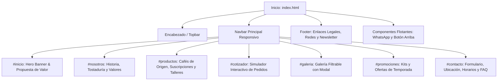

# Fase 2: Organización y Arquitectura de la Información
**Documento:** `docs/fase2_organizacion_arquitectura.md`  
**Proyecto:** Aroma & Grano - Página Web Empresarial  
**Fase Metodológica:** Fase 2 del Ciclo de Vida de Software  
**Estado:** Aprobado  
**Tipo de Información:** `[Simulado - Caso de Estudio Empresarial]`  

---

## 1. Arquitectura de Información y Estructura del Sitio

La solución web de **Aroma & Grano** implementa un modelo arquitectónico de **Single Page Application (SPA) informativa y comercial**, estructurada mediante anclajes semánticos optimizados para conversión. Este modelo garantiza:
* Navegación continua sin tiempos de recarga entre páginas.
* Experiencia fluida e intuitiva tanto en dispositivos móviles (mediante scroll táctil natural) como en equipos de escritorio.
* Indexación clara de secciones para motores de búsqueda y lectores de pantalla.

### 1.1. Mapa del Sitio (Sitemap Conceptual)



---

## 2. Jerarquía de Navegación y Patrones de Interacción

### 2.1. Navegación Primaria (Navbar Superior)
* **Comportamiento:** Barra fija superior (`fixed-top` con efecto translúcido y sombra sutil al hacer scroll), garantizando acceso permanente a los enlaces clave.
* **Componentes del Menú:**
  1. *Logotipo y Nombre de Marca:* Clic redirige a `#inicio` y resetea el scroll.
  2. *Enlaces Ancla:*
     * `Inicio` (`#inicio`)
     * `Nosotros` (`#nosotros`)
     * `Productos y Servicios` (`#productos`)
     * `Cotizador` (`#cotizador`)
     * `Galería` (`#galeria`)
     * `Promociones` (`#promociones`)
     * `Contacto` (`#contacto`)
  3. *Botón de Acción Rápida (CTA Destacado):* "Pedir Café" con estilo de botón primario contrastado que conduce directamente a la sección de contacto o cotización.
* **Comportamiento en Dispositivos Móviles:** Menú tipo "hamburguesa" colapsable con accesibilidad ARIA completa (`aria-expanded`, `aria-controls="navbarMenu"`), que se cierra automáticamente al seleccionar una opción para no obstruir la vista.

### 2.2. Navegación Secundaria y Enlaces Rápidos
* **Skip Link (Accesibilidad):** Enlace oculto al inicio del documento que se hace visible con la tecla `Tab`: `<a class="skip-link" href="#main-content">Saltar al contenido principal</a>`.
* **Scrollspy Dinámico:** Monitoreo de la posición de lectura en pantalla para activar visualmente el ítem correspondiente del menú mediante la clase `.active`.
* **Botón Flotante "Volver Arriba":** Aparece cuando el usuario ha descendido más de 400px en la página para permitir un retorno inmediato sin fricción.
* **Botón Flotante de WhatsApp:** Acceso directo a conversación con mensaje predeterminado.

---

## 3. Organización y Jerarquía de Contenidos

| Sección | Elemento Semántico | Objetivo de Comunicación | Contenido Específico |
| :--- | :--- | :--- | :--- |
| **Topbar** | `<div class="top-bar">` | Información práctica inmediata | Teléfono directo, dirección física, horario de atención y redes sociales. |
| **Hero (Inicio)** | `<header id="inicio">` | Impacto visual y propuesta de valor | Título principal H1, subtítulo con promesa de valor, botones CTA duales y sellos de confianza (100% Arábica, Comercio Justo). |
| **Nosotros** | `<section id="nosotros">` | Autoridad, cercanía y trazabilidad | H2 de sección, historia de la marca, pilares éticos, perfil del maestro tostador e indicadores cuantitativos de impacto. |
| **Productos** | `<section id="productos">` | Catálogo comercial y conversión | H2 de sección, pestañas/categorías de productos (Cafés de origen, Club de Suscripción, Talleres y Catering), tarjetas con precio, notas de cata y CTA. |
| **Cotizador** | `<section id="cotizador">` | Interactividad y generación de leads | H2 de sección, selector interactivo de origen, molienda y peso en kg, cálculo reactivo en tiempo real y botón de transferencia de pedido al formulario. |
| **Galería** | `<section id="galeria">` | Prueba visual y estética sensorial | H2 de sección, barra de filtros interactivos (Todos, Tostaduría, Variedades, Cafetería, Talleres), grilla de 6 tarjetas con efecto hover y apertura de modal lightbox. |
| **Promociones** | `<section id="promociones">` | Urgencia comercial y kits ahorro | H2 de sección, tarjetas de promociones destacadas, badges de descuento (-20%, 2x1), temporizador simulado de oferta limitada. |
| **FAQ** | `<section id="faq">` | Resolución de objeciones | H2 de sección, 5 ítems en acordeón accesible (`accordion` de Bootstrap) resolviendo dudas sobre envíos, molienda y pagos. |
| **Contacto** | `<section id="contacto">` | Cierre de conversión y atención | H2 de sección, formulario de contacto accesible con validación nativa y JS, datos de contacto, horario y mapa integrado simulado. |
| **Footer** | `<footer>` | Cierre institucional y navegación legal | Resumen de marca, enlaces rápidos, formulario de suscripción a newsletter, aviso legal simulado y copyright. |

---

## 4. Estructura y Organización de Archivos del Proyecto

El proyecto sigue una estructura limpia, desacoplada y estándar de la industria web frontend:

```
proyecto/
├── index.html                   # Documento raíz estructurado con HTML5 semántico
├── css/
│   └── styles.css               # Estilos personalizados, variables CSS, animaciones y responsive
├── js/
│   └── app.js                   # Módulo JavaScript para interactividad, cotizador, filtros y validación
├── img/
│   ├── logo.svg                 # Identidad visual de la marca en formato vectorial
│   ├── favicon.svg              # Icono de pestaña accesible
│   └── [activos gráficos]       # Imágenes optimizadas para productos, banners y galería
├── docs/                        # Carpeta obligatoria de documentación técnica del proyecto
│   ├── datos_proyecto.md        # Datos de la empresa, público y catálogo inicial
│   ├── fase1_analisis_requerimientos.md # Objetivos SMART y matriz MoSCoW
│   ├── fase2_organizacion_arquitectura.md # Estructura, sitemap y jerarquía de navegación
│   ├── fase3_experiencia_usuario_ux.md # Personas, User Journeys y heurísticas
│   ├── fase4_diseno_interfaz_ui_usabilidad.md # Sistema de diseño, paleta y tipografía
│   └── fase5_desarrollo_implementacion.md # Implementación técnica y matriz de pruebas
├── agente.md                    # Documento de configuración del agente en Markdown
├── agente.txt                   # Documento de configuración del agente en texto plano
└── README.md                    # Manual general del proyecto e instrucciones de ejecución
```

### 4.1. Criterios de Organización Técnica
* **Nombres de Archivo:** Todos en minúsculas, usando guiones bajos o guiones medios para evitar problemas de compatibilidad en servidores Linux/Unix.
* **Separación de Capas:** Cero estilos en línea (`style="..."`) dentro del HTML; cero lógica JavaScript en atributos de eventos (`onclick="..."`), delegando todo a escuchadores de eventos limpios en `app.js`.
* **Carga de Recursos Optimizada:**
  * Hojas de estilo cargadas en el `<head>`.
  * Fuentes web con `preconnect` para acelerar la descarga.
  * Scripts cargados al final del `<body>` con ejecución diferida para no bloquear el renderizado del DOM.
