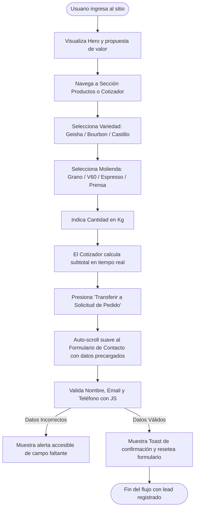

# Fase 3: Experiencia de Usuario (UX)
**Documento:** `docs/fase3_experiencia_usuario_ux.md`  
**Proyecto:** Aroma & Grano - Página Web Empresarial  
**Fase Metodológica:** Fase 3 del Ciclo de Vida de Software  
**Estado:** Aprobado  
**Tipo de Información:** `[Simulado - Caso de Estudio Empresarial]`  

---

## 1. Arquetipos de Usuario (User Personas)

Para fundamentar las decisiones de diseño en necesidades y frustraciones reales, se modelaron tres arquetipos de usuario representativos `[Simulado]`:

### Arquetipo 1: Camila Restrepo (La "Coffee Lover" Exigente)
* **Perfil:** 29 años, Diseñadora Gráfica, vive en apartamento céntrico, teletrabaja 3 días por semana.
* **Comportamiento:** Prepara café por las mañanas usando V60 y cafetera AeroPress. Lee sobre procesos de fermentación y le gusta probar nuevos perfiles de taza cada mes.
* **Motivaciones:** Encontrar café recién tostado (menos de 15 días desde la curva de tueste), conocer el origen exacto y la puntuación de cata, y apoyar negocios éticos.
* **Frustraciones:** Sitios web que no indican la fecha de tueste o el tipo de proceso (lavado, natural, honey), o que no permiten elegir el tipo de molienda específica para su método.
* **Objetivo en la Web:** Explorar las notas de cata de las variedades disponibles, revisar las opciones del Club de Suscripción mensual y cotizar un pedido para entrega a domicilio.

### Arquetipo 2: Carlos Mendoza (El Coordinador Corporativo)
* **Perfil:** 42 años, Gerente de Operaciones en una empresa de tecnología con 60 empleados.
* **Comportamiento:** Busca proveedores confiables para el café de la oficina y para los eventos trimestrales de la empresa.
* **Motivaciones:** Brindar a sus colaboradores y clientes un café de alta calidad que refuerce la imagen corporativa; busca procesos claros de cotización, facturación y puntualidad.
* **Frustraciones:** Formularios de contacto extensos que no reciben respuesta rápida, falta de información sobre catering y páginas lentas o confusas.
* **Objetivo en la Web:** Encontrar rápidamente la sección de servicios corporativos/catering, estimar el costo de café en grano mensual y enviar una solicitud de cotización formal en menos de 2 minutos.

### Arquetipo 3: Sofía Valenzuela (La Principiante Curiosa)
* **Perfil:** 23 años, Estudiante universitaria y creadora de contenido aficionada.
* **Comportamiento:** Toma café comercial habitualmente pero desea adentrarse en el mundo de los cafés especiales y busca un regalo original para el cumpleaños de su pareja.
* **Motivaciones:** Aprender sin sentirse intimidada por tecnicismos excesivos, participar en una experiencia presencial divertida y visualmente atractiva.
* **Frustraciones:** Contenidos que asumen que el usuario ya sabe de barismo y sitios donde es difícil ubicar los costos o los horarios de los talleres.
* **Objetivo en la Web:** Conocer la oferta del taller de barismo inicial, ver fotos reales de la experiencia en la galería y contactar por WhatsApp para resolver dudas rápidas.

---

## 2. Mapa del Recorrido del Cliente (Customer Journey Map - CJM)

A continuación se detalla el recorrido de **Camila** al interactuar con el sitio web:

| Etapa del Viaje | Acciones del Usuario | Puntos de Contacto (Touchpoints) | Emociones / Pensamientos | Puntos de Dolor Posibles | Oportunidad de Diseño UX |
| :--- | :--- | :--- | :--- | :--- | :--- |
| **1. Descubrimiento** | Llega al sitio mediante recomendación o búsqueda en Google. | Hero Banner, titular H1 y propuesta de valor. | Curiosidad: *"¿Qué hace especial a este café?"* | Si el sitio tarda en cargar o no se entiende qué ofrecen, abandona. | Carga en <1.5s, titular claro con propuesta de origen y llamado a la acción visible. |
| **2. Exploración** | Hace scroll para conocer la historia y métodos de tueste. | Sección "Nosotros", galería visual y sellos de calidad. | Confianza: *"Tienen trato directo con caficultores y tueste propio"*. | Duda sobre la frescura y la autenticidad del producto. | Galería fotográfica auténtica, citas del maestro tostador y métricas de impacto. |
| **3. Evaluación** | Revisa el catálogo de cafés de origen y promociones. | Sección de Productos, tarjetas con notas de cata y cotizador. | Interés analítico: *"El Geisha tiene 88.5 puntos SCA, me interesa"*. | No saber cuánto costará con el envío o dudar sobre la molienda. | Ficha clara de notas de cata, selector interactivo de molienda y calculadora instantánea. |
| **4. Conversión** | Utiliza el simulador de pedidos y completa el formulario. | Calculadora de café interactiva y formulario de contacto. | Satisfacción: *"Es rápido y puedo especificar mi método de filtrado"*. | Formularios largos o validaciones que borran los datos al equivocarse. | Formulario con autocompletado de cotización, validación en vivo y confirmación Toast. |
| **5. Post-interacción** | Recibe confirmación en pantalla y opción de enlace directo a WhatsApp. | Modal Toast de éxito y botón flotante de WhatsApp. | Certeza y tranquilidad: *"Me contactarán pronto con mi pedido listo"*. | No saber si el mensaje llegó con éxito. | Mensaje de éxito claro con datos de tiempo de respuesta estimado (<2 horas). |

---

## 3. Flujos de Usuario (User Flows)

### Flujo Principal: Selección y Cotización de Café de Especialidad

---

## 4. Aplicación de Principios de Usabilidad y Leyes de UX

1. **Ley de Fitts:** Los botones de llamado a la acción primarios (*"Explorar Catálogo"*, *"Cotizar Café"*, *"Enviar Solicitud"*) cuentan con dimensiones táctiles amplias (mínimo 48x48px en móvil) y espaciado generoso para evitar toques accidentales.
2. **Ley de Jakob:** Se respetan los patrones convencionales reconocidos por los usuarios: logotipo en la esquina superior izquierda que redirige al inicio, barra de navegación superior, carrito/contacto a la derecha y footer con enlaces corporativos al final.
3. **Ley de Hick:** La navegación se estructura en categorías claras para minimizar la carga cognitiva; en el cotizador interactivo, las opciones se agrupan en tres pasos sencillos (variedad, molienda, cantidad).
4. **Principio de Visibilidad del Estado del Sistema (Nielsen #1):**
   * El menú destaca la sección activa mientras el usuario hace scroll.
   * Los botones muestran efectos `:hover` y `:active`.
   * El envío del formulario despliega un indicador de procesamiento y un Toast de éxito inequívoco.
5. **Prevención de Errores y Recuperación (Nielsen #5 y #9):** Validación en tiempo real en los campos del formulario con mensajes amigables y específicos (ej. *"Por favor ingresa un correo electrónico válido como nombre@ejemplo.com"*).
6. **Accesibilidad y Flexibilidad de Uso (Nielsen #7):** Enlace de salto rápido al contenido principal para usuarios de teclado o lectores de pantalla (`skip-link`) y soporte para cualquier tamaño de pantalla.
